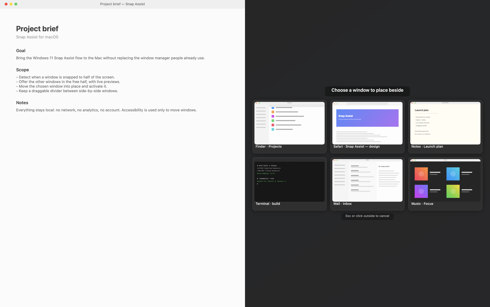

# Snap Assist

Una piccola app per la barra dei menu del Mac che porta su macOS lo **Snap Assist** di Windows: aggancia una finestra a metà o a un quarto e lo spazio libero mostra le altre finestre aperte; un clic e quella scelta riempie lo spazio.

**[Download per macOS](https://github.com/hellomoto8999/snap-assist/releases/latest)** · macOS 15+ · [English](README.md)

## Funzionalità

- **Pannello Snap Assist** — compare quando una finestra viene agganciata a metà o a un quarto, anche se l’altra metà è già occupata. Anteprime dal vivo, ordine dalla più in primo piano, `Esc` o clic fuori per annullare.
- **Metà e quarti** — funziona con Rectangle, Magnet, trascinamento ai bordi, scorciatoie da tastiera o il tiling nativo di macOS. Agganciando a un quarto, il pannello si apre nel primo quarto adiacente libero.
- **Barra di ridimensionamento** — appare solo sul confine tra finestre adiacenti; segue il puntatore, si afferra in qualsiasi punto e ridimensiona entrambe le finestre mantenendo i bordi esterni.
- **Layout stile FancyZones** — preset (metà, terzi, centro + lati, righe, 2×2, principale + colonna, colonna + principale, 3×2, 2×3) ed editor libero sul canvas. Tieni premuto **Shift** e trascina una finestra per vedere le zone e rilasciarla dove vuoi.
- **Centra con Control** — premi **Control** due volte (o tre) per centrare la finestra in primo piano sul suo schermo. Control usato come modificatore (Ctrl+C, Ctrl+clic, Ctrl+scroll) non attiva il gesto.
- **Retroilluminazione tastiera** — tieni premuto **Fn** e premi **F1** / **F2** per abbassare o alzare la retroilluminazione del MacBook. Snap Assist rimappa i tasti: **è macOS a gestire il livello e a mostrare il suo HUD nativo** sul monitor attivo, anche con schermi esterni.
- **Avvio al login** — un interruttore nelle Impostazioni.
- **Solo barra dei menu** — nessuna icona nel Dock; il menu contiene solo **Impostazioni…** ed **Esci**.
- **Italiano e inglese** — l’interfaccia segue la lingua di macOS.
- **Impostazioni organizzate** — **Snap**, **Mouse**, **Tastiera** e **Generale**, più le sezioni **Layout** e **Permessi**.

## Installazione

1. Scarica il DMG più recente e trascina **SnapAssist.app** in Applicazioni.
2. Al primo avvio fai clic destro sull’app → **Apri** (non è notarizzata).
3. Concedi **Accessibilità** (obbligatoria) e, se vuoi le anteprime, **Registrazione schermo**.

**[Guida completa: uso, permessi, layout e limitazioni →](docs/GUIDE.it.md)**

## Requisiti

- macOS 15 o successivo.
- Permesso **Accessibilità**. **Registrazione schermo** è opzionale (solo per le anteprime).

## Licenza

MIT — vedi [LICENSE](LICENSE).
