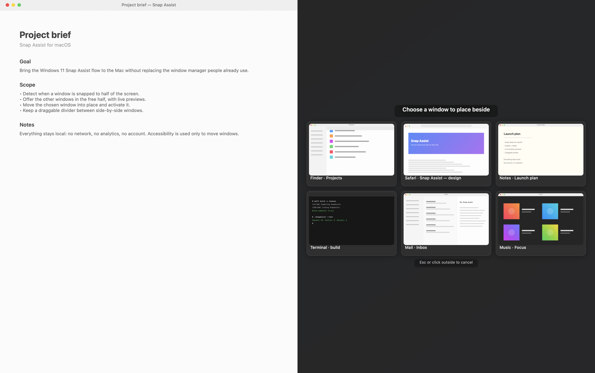

# Snap Assist

A tiny macOS menu bar app that brings Windows' **Snap Assist** to the Mac: snap a window to a half or a quarter and the free space shows your other open windows; one click and the chosen window fills it.

**[Download for macOS](https://github.com/hellomoto8999/snap-assist/releases/latest)** · macOS 15+ · English | [Italiano](README.it.md)

## Features

- **Snap Assist picker** — appears when a window is newly snapped to a half or a quarter, even if the other half is already occupied. Live thumbnails, frontmost-first order, `Esc` or click outside to cancel.
- **Halves and quarters** — works with Rectangle, Magnet, edge dragging, keyboard shortcuts or macOS native tiling. When you snap to a quarter, the picker opens in the first free adjacent quarter.
- **Resize divider** — hover-only bar on the boundary between adjacent windows; it follows the pointer, can be grabbed anywhere along its length and resizes both windows while keeping their outer edges.
- **FancyZones-style layouts** — presets (halves, thirds, center + sides, rows, 2×2, main + stack, 3×2, 2×3) and a free-form canvas editor. Hold **Shift** and drag a window to see the zones and drop it where you want.
- **Center with Control** — double-tap (or triple-tap) **Control** to center the focused window on its screen. Control used as a modifier (Ctrl+C, Ctrl+click, Ctrl+scroll) does not trigger it.
- **Keyboard backlight** — hold **Fn** and press **F1** / **F2** to dim or brighten the MacBook keyboard backlight. Snap Assist remaps the keys so **macOS handles the level and shows its own native HUD** on the active display — including external monitors.
- **Launch at login** — one switch in Settings.
- **Menu bar only** — no Dock icon; the menu contains just **Settings…** and **Quit**.
- **English and Italian** — the UI follows the macOS language.
- **Organized Settings** — **Snap**, **Mouse**, **Keyboard** and **General**, plus dedicated **Layouts** and **Permissions** sections.

## Install

1. Download the latest DMG and drag **SnapAssist.app** to Applications.
2. On first launch, right-click the app → **Open** (it is not notarized).
3. Grant **Accessibility** (required) and, optionally, **Screen Recording** for the window thumbnails.

**[Full guide: usage, permissions, layouts and limitations →](docs/GUIDE.md)**

## Requirements

- macOS 15 or later.
- **Accessibility** permission. **Screen Recording** is optional (only for thumbnails).

## License

MIT — see [LICENSE](LICENSE).
