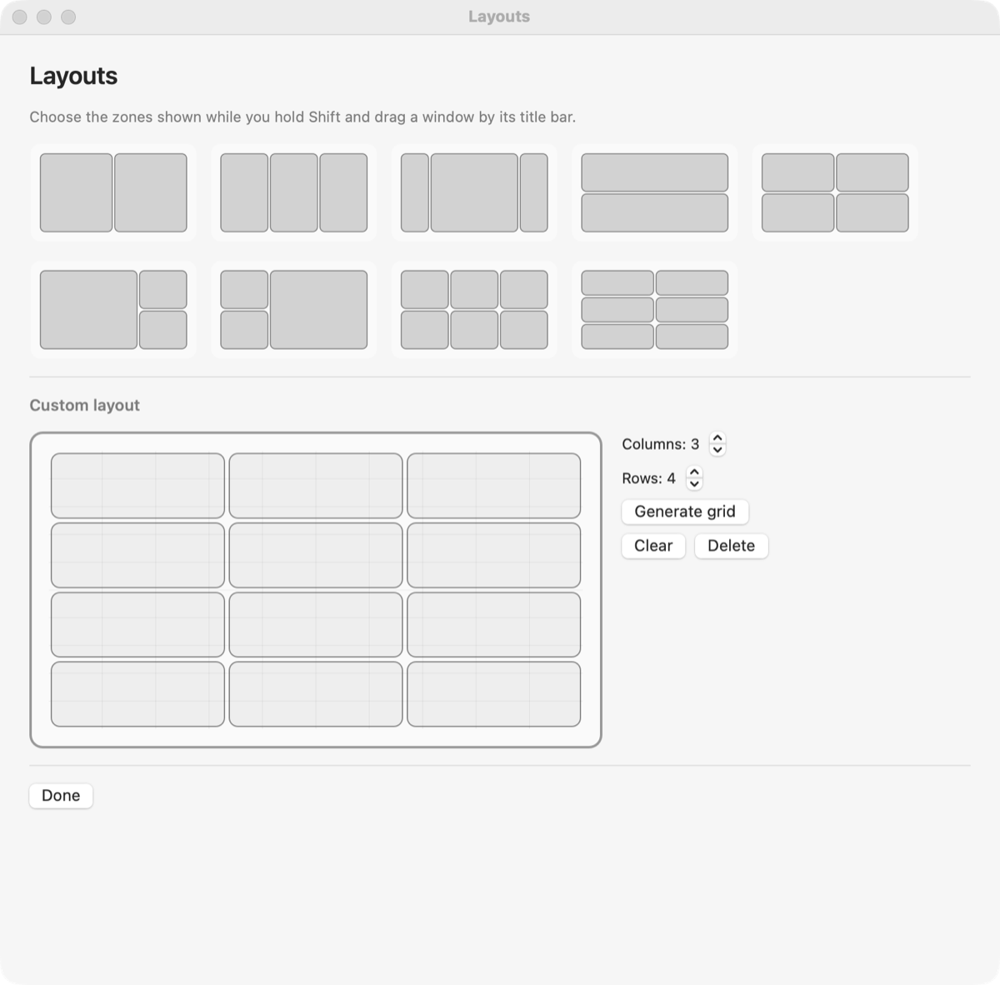

# Snap Assist — Guida

[← Torna alla home](../README.it.md) · [English](GUIDE.md) · Italiano

Tutto ciò che sta oltre l’elenco delle funzionalità: requisiti, permessi, uso, layout, limitazioni e disinstallazione.

## Requisiti

- macOS 15 o successivo.
- Permesso **Accessibilità** (obbligatorio).
- Permesso **Registrazione schermo** (opzionale, solo per le anteprime delle finestre).

## Lingua

L’interfaccia segue la lingua di macOS: **inglese** di default, **italiano** quando il sistema è in italiano. Non c’è nulla da configurare.

Per forzare la lingua solo per Snap Assist: Impostazioni di Sistema → Generali → Lingua e regione → App → Snap Assist.

## Permessi

Al primo avvio l’app apre un pannello **Permessi** con lo stato di entrambi i permessi e i pulsanti che portano direttamente al pannello giusto di Impostazioni di Sistema. Mentre il pannello è aperto l’app compare anche nel Dock e in ⌘Tab; chiudendolo torna a essere solo un’icona nella barra dei menu.

| Permesso | A cosa serve | Dove |
|---|---|---|
| **Accessibilità** | leggere posizione/dimensioni della finestra in primo piano e spostare quella scelta | Impostazioni di Sistema → Privacy e sicurezza → Accessibilità |
| **Registrazione schermo** | catturare le anteprime delle finestre per il pannello di scelta | Impostazioni di Sistema → Privacy e sicurezza → Registrazione schermo |

Senza Accessibilità l’app non può funzionare. Senza Registrazione schermo funziona lo stesso, ma mostra le icone delle app invece delle anteprime. Dopo aver concesso la Registrazione schermo potrebbe essere necessario riavviare l’app (**Riavvia Snap Assist** nel pannello).

> Se i permessi sembrano “dimenticati” dopo una ricompilazione, assicurati di aver creato l’identità di firma stabile con `./scripts/setup-signing.sh`: con una firma ad-hoc il permesso va concesso di nuovo a ogni build.

## Uso

1. Aggancia una finestra alla metà sinistra (o destra) con Rectangle o trascinandola al bordo.
2. Dopo circa mezzo secondo la metà libera si scurisce e mostra le altre finestre.
3. Clicca quella da affiancare: viene spostata, ridimensionata e portata in primo piano.
4. `Esc` o un clic fuori dal pannello annulla.

Le finestre sono ordinate dalla più in primo piano alla più indietro, come su Windows. Le finestre dell’app e quella appena agganciata sono escluse. Il pannello compare ogni volta che una finestra viene **appena** agganciata a metà o a un **quarto**, anche se l’altra metà è già occupata; cliccare una finestra già agganciata non lo riapre.

Quando agganci una finestra a un quarto, il pannello compare nel primo quarto adiacente libero (in alto a destra per una finestra in alto a sinistra, e così via).

**Centra con Control**: premi **Control** due volte (o tre, configurabile in Impostazioni → Mouse) per centrare la finestra in primo piano sul suo schermo. Control usato come modificatore (Ctrl+C, Ctrl+clic, Ctrl+scroll) non attiva il gesto.

**Retroilluminazione tastiera**: su un MacBook con tastiera retroilluminata, tieni premuto **Fn** e premi **F1** per abbassare o **F2** per alzare la retroilluminazione. Snap Assist rimappa i tasti, quindi **è macOS a gestire il livello e a mostrare il suo HUD** — la stessa barra della luminosità display — sul monitor attivo, anche con schermi esterni. F1/F2 senza Fn continuano a regolare la luminosità del display. Disattivabile in Impostazioni → Tastiera; disattivandola, la mappatura viene rimossa.

**Avvio al login**: attiva **Avvia al login** in Impostazioni → Generale (macOS potrebbe chiederti di approvarlo in Impostazioni di Sistema → Generali → Elementi login).

**Barra dei menu**: il menu contiene solo **Impostazioni…** (⌘,) ed **Esci da Snap Assist** (⌘Q). Tutte le opzioni sono nella finestra Impostazioni.

## Barra tra le due finestre

Quando due finestre occupano due aree adiacenti dello stesso schermo — metà, quarti o griglia — sul confine compare una barra che permette di ridimensionarle entrambe insieme. È verticale tra finestre affiancate e orizzontale tra finestre sovrapposte.

- La barra **appare solo quando il puntatore è proprio sul confine** (entro circa 8 punti), quindi non salta fuori mentre usi una barra laterale o passi vicino. Non sta sopra le altre app e non copre il resto dello schermo.
- Passandoci sopra appare una piccola maniglia con tre puntini che segue il puntatore; puoi afferrare la barra **in qualsiasi punto della sua lunghezza**, non solo sulla maniglia. Il cursore diventa orizzontale o verticale e, trascinando, entrambe le finestre si ridimensionano mantenendo i bordi esterni (minimo 120 punti ciascuna).
- Resta dopo aver spostato la divisione (es. 60/40), finché le due finestre rimangono adiacenti.
- Ogni schermo ha la sua barra quando ci sono coppie adiacenti su entrambi.
- Si nasconde quando si apre il pannello di scelta, quando le finestre non sono più adiacenti o quando un’altra finestra copre il confine.
- Si può disattivare in **Impostazioni → Snap**.

## Layout (Shift + trascinamento)

In **Impostazioni → Layout** scegli un preset — metà, terzi, **centro + lati**, righe, 2×2, principale + colonna, colonna + principale, 3×2, 2×3 — oppure costruisci il tuo sul canvas: trascina su un’area vuota per disegnare una zona, dentro una zona per spostarla, sui bordi per ridimensionarla, ed eliminala con **Elimina**. **Genera griglia** ti dà un punto di partenza.

Poi tieni premuto **Shift** e trascina una finestra dalla barra del titolo. Le zone compaiono in un overlay; passa sopra una zona e rilascia per posizionare lì la finestra. L’overlay è per schermo, ignora gli eventi del mouse e il trascinamento continua a funzionare normalmente.

## Limitazioni note

- Le finestre delle app che rifiutano il ridimensionamento programmatico (alcuni pannelli di Impostazioni di Sistema, alcuni pannelli) non vengono spostate: l’app emette un suono.
- Le finestre sugli altri Space non vengono proposte (solo quelle visibili).
- Con Stage Manager attivo i frame sono sfalsati e il rilevamento può non scattare.
- Non firmata/notarizzata per la distribuzione: è un progetto personale, non un’app del Mac App Store.

## Disinstallazione

1. Esci da Snap Assist (menu → Esci).
2. Elimina `SnapAssist.app`.
3. Se vuoi, rimuovi la sua voce da Accessibilità e Registrazione schermo in Impostazioni di Sistema.

Le preferenze restano in `~/Library/Preferences/com.frank.snapassist.plist`.

## Risoluzione dei problemi

- **“Impossibile aprire l’app”**: clic destro sull’app → **Apri**, oppure esegui `xattr -dr com.apple.quarantine /Applications/SnapAssist.app`.
- **I permessi sembrano azzerati dopo una ricompilazione**: usa l’identità di firma stabile (`./scripts/setup-signing.sh`) e concedi di nuovo i permessi.
- **Nessuna anteprima**: concedi Registrazione schermo e riavvia Snap Assist.
- **La retroilluminazione non reagisce**: funziona solo su MacBook con tastiera retroilluminata e con l’opzione attiva in Impostazioni → Tastiera. Quando l’opzione è disattivata (o Snap Assist non è in esecuzione) Fn+F1/F2 tornano alla luminosità del display.

## Licenza

MIT — vedi [LICENSE](../LICENSE).
